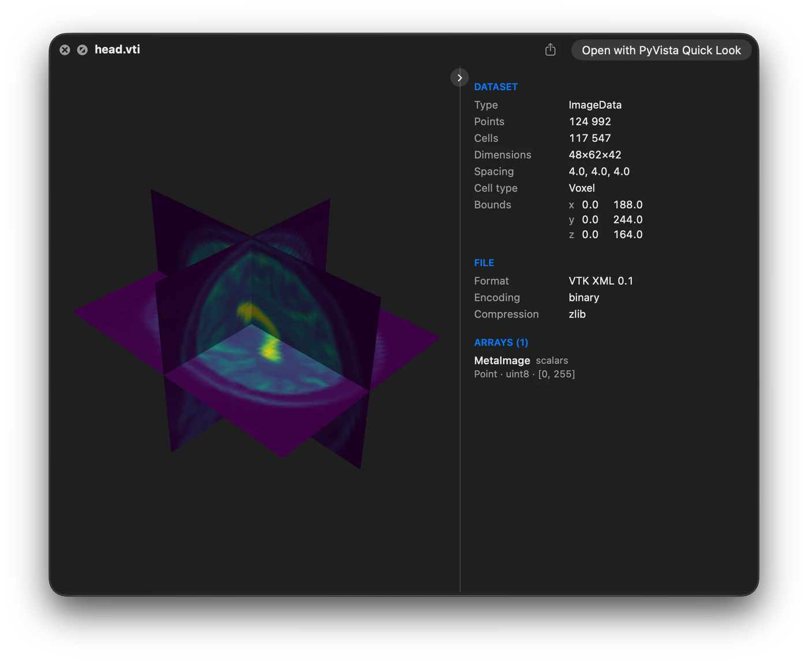

How it works
============

The app bundle contains a Quick Look extension that declares a uniform type identifier
for each claimed extension. When the Finder previews one of those files, the extension
hands it to a background render service, which reads it with PyVista, extracts the
surface, colours the vertices by the active scalars, and writes a PLY. The extension
shows that PLY in a SceneKit view, which is what makes the preview turnable. The scene
is lit by VTK's light kit, which turns with the camera, so its colours match PyVista's
own renders; faces are drawn flat unless the theme shades smoothly.

Drawing
-------

Point data is interpolated across each face. Cell data is drawn flat: the cells are
split apart first, so each keeps its own colour. Lines and point clouds are drawn as
PyVista draws them: unlit, lines at the theme's ``line_width`` and points as round
points of its ``point_size``, both in pixels, so a saved theme sets them. Lines are never
drawn thinner than two pixels, since one pixel is a hairline on a Retina display.

A volume that carries scalars is cut into three slices through its centre; one without
is shown as its outer surface. Both sides of every face are drawn and lit, as PyVista
draws them, so an open surface or a slice shows from wherever the camera looks.

Surfaces are sent whole up to ``max_scene_points``. Above that, images and volumes are
thinned on their lattice and other surfaces are decimated, or binned onto a grid above
4 million points. The grid uses at most about 1 GB of memory, so a compact surface
binned that way can end below a large ``max_scene_points``. The preview then has fewer
points and cells than the file, and its shape can differ in fine detail.
``pvql config set max_scene_points 0`` sends every surface whole, at the cost of slower
previews of large files.

Cache
-----

Previews are cached under ``~/Library/Caches/PyVistaQuickLook``, keyed by the file's
path, size, and modification time, so editing a file invalidates its preview, and by the
version of the converter, so an update rebuilds them rather than serving old ones.

The render service deletes previews of files that have changed or gone when it starts
and then once a day (``cache_check_minutes``); ``pvql cache --prune`` does it now,
dropping previews built by an older version too, and ``pvql cache --clear`` empties the
cache. Changing a setting that previews depend on, such as the theme, leaves the
previews built under the old one until they are pruned or cleared.

A preview is kept whenever the service cannot tell: its file is on a disk that is not
plugged in, a share that is not mounted, or in a folder macOS keeps private and no
preview has read since the service started, so a check never raises a permission prompt
of its own.

The service loads PyVista and VTK in the background when it starts, which is at login
and whenever it is reinstalled, so the first preview does not wait for them.
``pvql preload`` does the same on demand.

Large files
-----------

A ``.pv`` file is read with only the array it is coloured by. Its other arrays are read
one at a time for their ranges, so a file never needs its arrays and its mesh in memory
at once. A VTK XML file above 256 MB is read the same way, its other ranges taken from
the header. A vector's range is that of its magnitude, shown as ``||v||``, in every
format. Files saved with a thumbnail open faster still: see :ref:`fast-previews`.

For a file of 32 MB or more, the dataset panel appears as soon as the header is read,
with a spinner where the render goes until the preview is ready.

Previews are built side by side while their estimated memory, about six times each
file's size, fits within half the Mac's memory (``max_conversion_memory_mb``); the rest
wait their turn, and a file too big for that budget is built on its own. Moving on from
a slow file does not cancel it, so it is ready when you come back, unless its conversion
runs past ``timeout``.

A file above ``max_file_size_mb`` is not converted or copied when it is selected. The
panel shows what its header says, and a Preview Anyway button previews it once.

A claimed file that turns out not to be a mesh is shown the way Quick Look would have
shown it: as plain text when it reads as text, such as a ``.dat`` holding a table of
numbers, and otherwise as its icon, name, size, and date, with a line saying why it
holds no mesh. Any other failure, such as a render service that is not running or a
conversion that timed out, is reported in full instead.

Compressed and multi-file datasets
----------------------------------

Two kinds of dataset are not a single file with a claimable extension, and both are
reached by claiming the type macOS gives them instead.

A compressed dataset is named ``.nii.gz`` or ``.vol.gz``, but Launch Services sees only
``.gz`` and keeps its own type for it, so declaring those extensions does nothing. The
extension claims the gzip type: press space on a gzipped NIfTI, PERMAS, Netgen, or Medit
file and it is drawn like any other. Every other gzip, a tarball or a compressed log,
shows its details.

A DICOM series is a folder of slices, so the folder is what gets previewed. Press space
on one in the Finder and the slices are read as a single volume, cut through its centre
and coloured, the same as any other volume. An ordinary folder shows its own details
immediately, as the Finder would.

.. _render-service:

The render service
------------------

macOS runs Quick Look extensions in a sandbox that VTK cannot run inside, so reading and
conversion happen in a launch agent instead, which the installer writes to
``~/Library/LaunchAgents`` and starts.

.. code-block:: bash

   pvql service            # report whether it is loaded
   pvql service --install  # (re)install and start it
   pvql service --uninstall

It appears as ``pyvista-quicklook-daemon`` under Login Items & Extensions in System
Settings, next to the app's own entry, where it can be switched off; its output goes to
``~/Library/Logs/pvqld.log``.

.. _protected-folders:

Files in the Desktop, Documents, and Downloads folders
------------------------------------------------------

macOS keeps those folders private to each program, and the render service cannot read
them. The Quick Look extension copies the file it was asked to preview into its own
container so that the service can convert it anyway.

A dataset that points at neighbouring files (``.pvd``, ``.vtm``, ``.case``, ``.foam``,
``.xdmf``, ``.xmf``) needs those neighbours, which the copy does not include. Keep such
datasets outside those three folders, or grant the render service Full Disk Access in
System Settings under Privacy & Security. The service runs from the app nested at
``~/Applications/PyVista Quick Look.app/Contents/Library/PyVista Quick Look.app``; in the
file picker that opens from the + button, press Cmd-Shift-G and paste that path.
