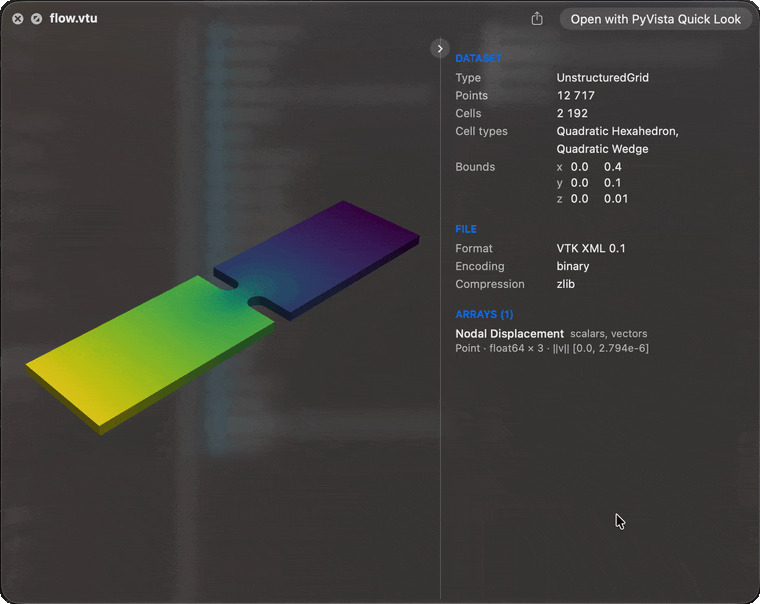

PyVista Quick Look
==================

Press the space bar on a mesh file in the Finder and turn it with the mouse, the same
way macOS already previews ``.ply`` and ``.usdz`` models.

Selecting ``flow.vtu`` and pressing space shows its surface in the Quick Look panel,
coloured by the active scalars and free to rotate and zoom, with a panel of what the
dataset holds beside it. Over 80 formats that `PyVista <https://docs.pyvista.org>`_ reads
are claimed, from VTK's own to Exodus, Gmsh, NIfTI, STEP and OpenFOAM.

.. code-block:: bash

   curl -LsSf https://github.com/pyvista/pyvista-quicklook/releases/latest/download/install.sh | sh

macOS 15 or newer. Nothing else needs to be installed first. Then select a ``.vtu``,
``.vtp``, or ``.vtk`` file in the Finder and press space.

.. note::

   A preview is for a quick look, not for measuring. Its geometry may be processed
   before it is shown: a large surface is thinned, a volume is cut into slices, cells
   are split apart to colour them. What you turn in the panel can therefore differ from
   the mesh PyVista loads from the file. The counts, bounds and ranges in the dataset
   panel describe the file itself.

.. grid:: 1 1 2 2
   :gutter: 3

   .. grid-item-card:: The dataset beside the picture
      :img-top: _static/preview-panel.png
      :link: usage
      :link-type: doc

      Type, points, cells, arrays and bounds, beside or below the preview.

   .. grid-item-card:: Volumes as slices
      :img-top: _static/preview-volume.png
      :link: how-it-works
      :link-type: doc

      A volume with scalars is cut into three slices through its centre.

   .. grid-item-card:: Pictures in the Finder
      :img-top: _static/finder-thumbnails.png
      :link: usage
      :link-type: doc

      Files saved with a pyvista-zstd thumbnail show it as their icon.

   .. grid-item-card:: Your PyVista theme
      :img-top: _static/preview-document-theme.png
      :link: settings
      :link-type: doc

      Colours, colormap, shading and lighting follow a PyVista theme.

.. toctree::
   :maxdepth: 2

   install
   usage
   settings
   formats
   how-it-works
   troubleshooting
   commands
