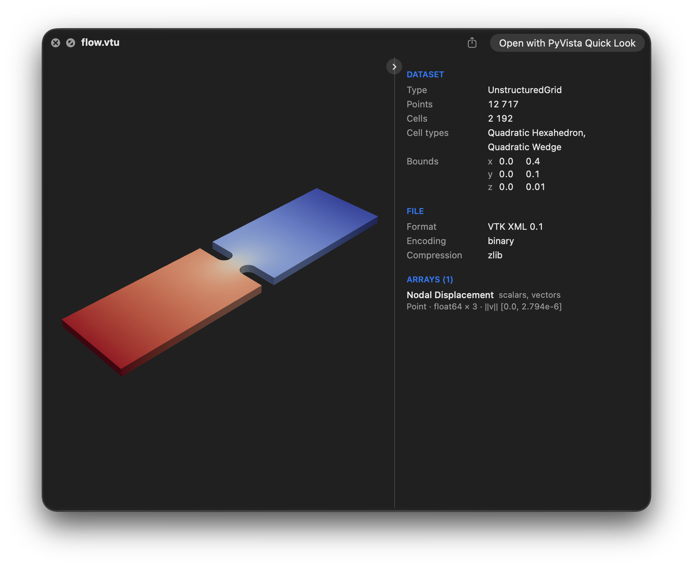
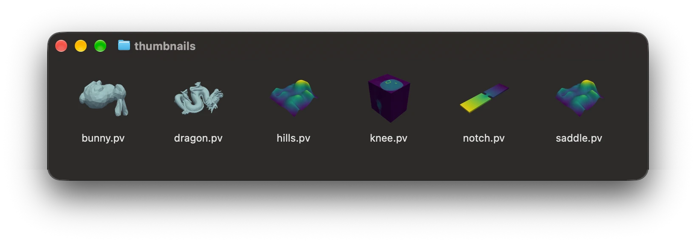
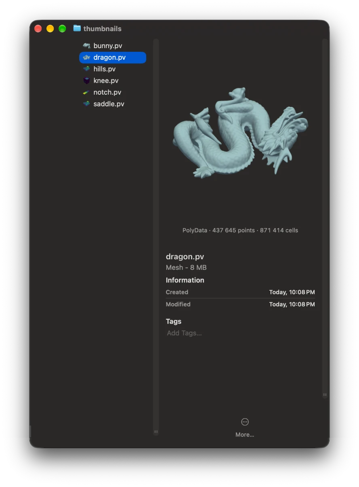

Using the preview
=================

Select a claimed file in the Finder and press space. The preview shows the surface
coloured by the active scalars, with the dataset panel beside it.

   ``flow.vtu`` in the ``paraview`` theme, coloured by its displacement.

Turning the surface
-------------------

The mouse moves the camera as it does in PyVista:

- drag to turn the surface
- drag with shift held, or with the middle button, to pan
- drag with the right button, drag with shift and control held, roll the wheel or pinch
  to zoom
- drag with control held to spin it about the line of sight

The dataset panel
-----------------

The panel listing the dataset's type, points, cells, arrays and bounds sits beside or
below the preview as the panel's size allows. Drag the line between them to resize it.
The button on that line folds the panel away and back: to the line alone beside the
preview, or to one line below it. The preview remembers both.

``pvql config set info_panel below`` fixes it below, ``side`` beside, ``compact`` keeps
one line, and ``hidden`` leaves it out.

Turnable or still
-----------------

By default every preview is a surface to turn and zoom. To get still images instead,
rendered by ``pyvista plot`` with the scalar bar and axes that the turnable view leaves
out:

.. code-block:: bash

   pvql config set interactive false

Still images take ``window_size``, ``background`` and ``extra_args`` from the
:doc:`settings <settings>`, and a theme by name only; a saved theme file always draws the
turnable view.

Opening in a window
-------------------

The claimed formats also open in the app: double-clicking one shows the same preview,
render and dataset panel alike, in a window of its own. The app is their default opener
unless another app that reads them, such as ParaView, says it is, and Open With chooses
between them. The compressed formats claimed through gzip and DICOM folders are not
opened by the app, since it would otherwise offer to open every gzip archive and folder.

.. _fast-previews:

Fast previews with pyvista-zstd
-------------------------------

A very large file previews fastest when saved with
`pyvista-zstd <https://github.com/pyvista/pyvista-zstd>`_ with ``thumbnail=True``, which
stores a pre-rendered picture. PyVista Quick Look reads the thumbnail and the file's
metadata almost instantly, so a file saved this way opens on its picture without loading
the mesh or rendering it.

.. code-block:: python

   import pyvista_zstd

   pyvista_zstd.write(mesh, 'mesh.pv', thumbnail=True)

A file with a current picture shows it in the Finder as its icon, and opens on it
without reading the data, with the dataset's details beside it. Clicking, dragging,
scrolling or pinching the picture loads the turnable surface in its place, on the same
view, with the picture dimmed until it is ready. Every other file, and a ``.pv`` file
whose picture is older than its data, goes straight to the turnable surface.
``pvql config set force_interactive true`` opens every file that way, and a picture then
only stands in while the surface loads. Opening a file with the app always shows it in
3D.

``thumbnail=True`` renders a 512 × 512 PNG with PyVista's default camera, in the global
theme, cropped to the dataset on a transparent background; PNG bytes of your own are
embedded as they are. The picture sits uncompressed near the start of the file, with a
checksum of the file's index, so the extension reads it with a few small reads and can
tell when the data was changed after the picture was taken. Thumbnails need pyvista-zstd
0.7 or newer.
